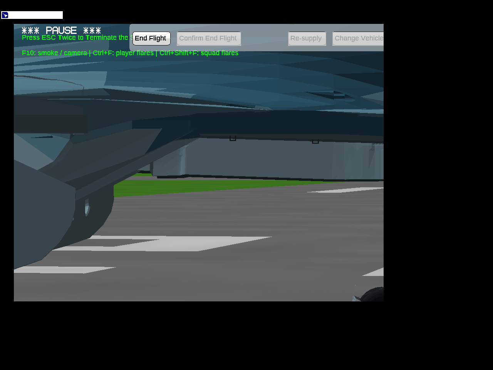
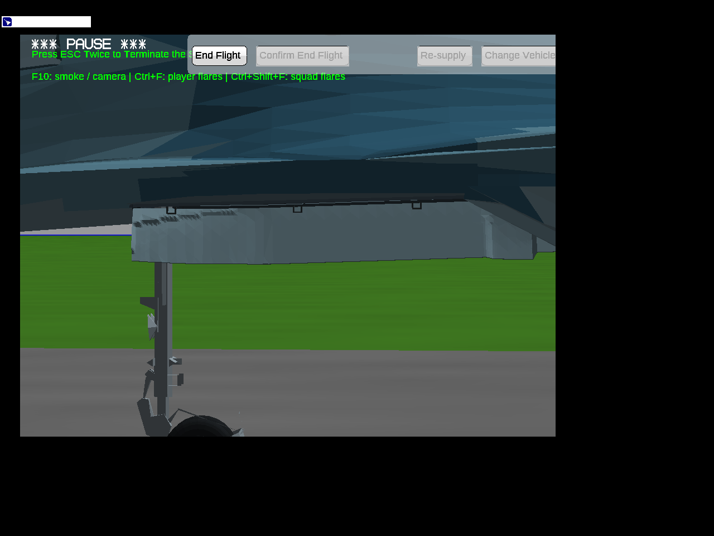
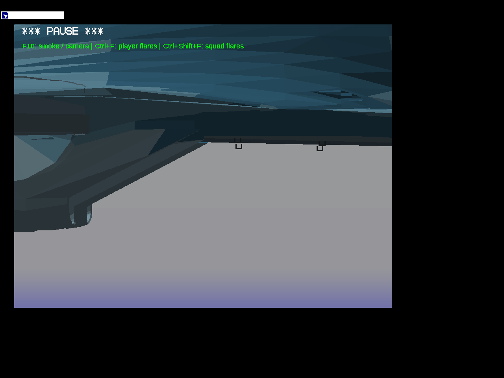

# Су-34: просвет передней створки

Кандидат в ветке `task/su34-nose-door-gap`. Включение в общую игру владельцем не подтверждено.

База: Release `su30sm-vectornozzles-before-cobra-20261115`, архивы Windows x86/x64. SHA-256 исходной `runtime/aircraft/su34.dnm`: `dadaddbd32530a68b9ef80413fc37741df073df3eacaca23c580951198fdfce9`. Код ветвления: `5b5d672c51de120a4e0769f3768cdc1e668991d1`.

Исправлена неподвижная подкладка передней ниши `RecessedNoseBaySeal.srf`: узкое перекрытие шва 35 мм и четыре небольших П-образных крепления с каждой стороны по примеру владельца. Широкий первоначальный вариант заменён. Подвижная геометрия створок, все узлы, классы и таблицы анимации сохранены. Крепления декоративные, неподвижные; отдельная механика петель не добавлялась.

## Воспроизведение

Установить зависимости `model-source/requirements.txt` в отдельное Python-окружение. Выполнить из корня репозитория:

```sh
python aircraft/su34/src/su34-private-converter/close_nose_door_gap.py /path/to/original/su34.dnm /path/to/output/su34.dnm
```

Заменить только `runtime/aircraft/su34.dnm` в отдельной локальной игровой копии. Скрипт проверяет точную исходную модель, запрещает запись поверх входа и сравнивает все узлы и остальные поверхности после записи.

## Проверка

Реальный запуск Windows x64 через Wine 10 / Xvfb: передняя ниша с обеих сторон на земле, отдельная сцена с убранным шасси в воздухе. Светлая щель в проверенных боковых ракурсах перекрыта. Полный цикл движения шасси и настоящая Windows не проверены; неизменность анимации подтверждена сравнением всех данных узлов. x86 не запускался.






Полные игровые ZIP подготовлены локально в `/workspace/ysflight-dev/su34-delivery/`; SHA-256 и проверки находятся в `checks.json` рядом с архивами. Проверяются CRC, архитектура EXE и побайтовое равенство всех файлов базы, кроме `runtime/aircraft/su34.dnm`. Публичный релиз с геометрией Су-34 не создан: права на её распространение по PROJECT.md не подтверждены. Ссылок на новые GitHub Release нет. Поставка через GitHub не завершена.
