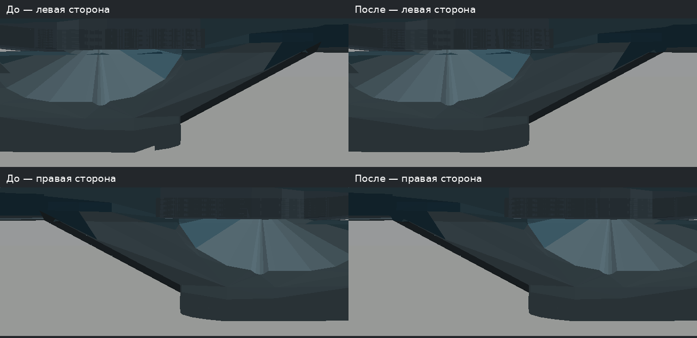

# Су-34: локальная доводка двух кромок

База: полная поставка b6470cf3, private draft448538472. Итог:4aaaedfe34aee1247861eec4d2547642acba1b4aa36b17ccc3d8fbef36909eb9.

| Место | До | После |
|---|---|---|
| Верхний передний скос обоих входов | Внутреннее затемнение захватывало наружный скос и выглядело чёрным выступом | Граница затемнения перенесена за скос; возвращён существующий наружный материал точной обратной грани. Размеры и поверхность сохранены |
| Нижняя кромка второго, положительного X входа |24 записи граней и обратных сторон использовали внутреннюю кромку вместо наружной, оставляя выемку | Переподключены к существующим наружным вершинам; удалены два схлопнувшихся нулевых ребра. Координаты исходных вершин не менялись |

Изменён только SourceAirframe.srf. Все прочие меши,17 узлов шасси, родительские связи и анимационные записи побайтно прежние. Сужение обоих входов на6%, центры и высота сохранены. Это исправление границы материала и локального соединения, не новая общая форма и не перекраска самолёта.

Фактически открыты игровые снимки Wine x64: два профиля, фронт, два соседних угла, оба профиля с выпущенным шасси. Расчётное сравнение контактов с17 мешами шасси при0/.5/1: новых пар нет. Нулевых треугольников0до/0после. Точное воспроизведение и откат проверены. Обычные грани исходной модели не сглаживались; это не полный аудит самолёта. Повторного нативного запуска Windows нет.

Сборки и геометрия остаются в авторизованном черновике GitHub Releases согласно PROJECT.md. Полный исходный движок и предыдущие исходники сохраняются в CorrespondingSources ZIP. Старый draft448538472 не изменён.
