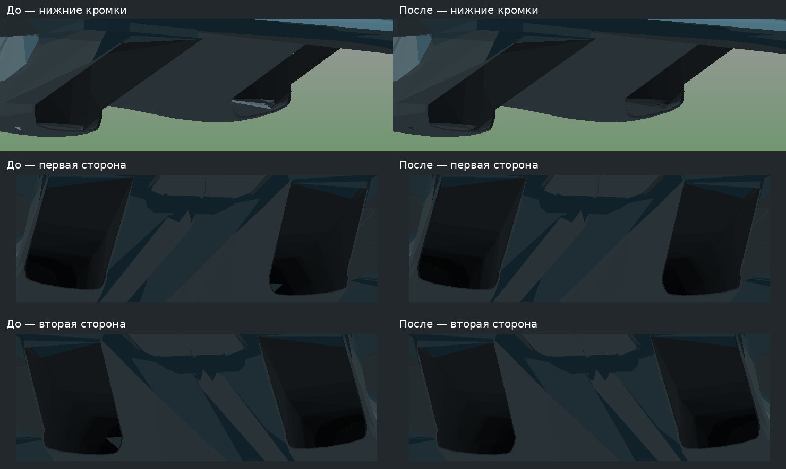

# Су-34: нижние внутренние кромки и просвет у стенки ниши

Базаd4dc6f68fe3761a9a5d84b8823af728dedca023e8e7c8c7ff06dde5e931a81e7 из предыдущего неизменённого private draft448779195. Новая модельb26826d172ecb83d5f6063c4c620004cecaf1d5b5a6da4799ea40c1f2d3f257c.

| Отметка владельца | Подтверждённая причина | Локальная правка |
|---|---|---|
| Светлые полосы и маленький скол у нижнего бортика | Обращённые внутрь грани нижней обшивки оставались с наружным материалом135/167/180. Поцветовая диагностика показала SourceAirframe5575,7687/7688,7699/7700 и зеркальные поверхности | Исправлена палитра247 внутренних граней в ограниченной зоне обеих кромок. Наружные обратные стороны и существующие нормали/индексы/координаты сохранены |
| Треугольник в глубине | Видимая часть Su34RearBayInnerWallL/R (например118,132,152 слева и111,113,125 справа) пересекала видимый проход недостаточно отделённого верхнего бокового участка канала | Ниши не изменены. Добавлена локальная фасеточная стенка обхода в SourceAirframe:160 двусторонних записей. Она сопрягается с исходной обшивкой и прежним задним экраном наZ=-3.35 |

Новая стенка построена по пересечениям исходных поверхностей, с плоскостью обхода `sign(X)*X+Y=1.07`. Стенка ниши находится при |X|=1.52,Y>=-.42; от новой стенки до неё остаётся21.2мм по нормали. Участок сужается к существующей боковой стенке; форму входа и положение заднего экрана не переносили. Это локальный обход неподвижной стенки ниши внутри канала. Данные геометрии исходной модели не публикуются; генератор работает от разрешённой приватной основы.

Изменён только SourceAirframe.srf. Все исходные вершины, индексы, нормали и яркость существующих граней точные; изменены только выбранные C-записи и добавлены внутренние грани. Все другие меши и узлы, включая ниши,17 деталей шасси, их родители и анимации, побайтно точные. Крылья, элероны, отсутствие пилонов, DAT, физика, коллайдер, внешняя окраска и EXE прежние.

Проверки:0 вырожденных треугольников. Новые стенки против17 мешей шасси при0/.5/1 и двух стенок ниш —0 контактов. CLI-генератор воспроизвёл модель с тем же SHA. Точный обратный патч проверен до байта, предыдущий private draft448779195 сохранён. Реально запущена игра Wine x64 и открыты кадры до/после с ракурсов жалобы140/+5,170/-12,190/-12, а также прямой передний, соседние155/205 и верхний190/+5. Дополнительно открыты промежуточное и выпущенное положения шасси. Повторного nativeWindowsзапуска нет. Это локальная проверка двух отметок, не полный аудит самолёта.

Код: src/intake-specks/repair.py (материалы кромки/сборка), fit.py (сопряжение обхода), package.py (полные игры из предыдущего draft). Helpers ../intake-front/dnm.py,mesh.py; numpy2.3.5 иPillow. Команда: `python repair.py --baseline baseline.dnm --output su34.dnm --report report.json`. Полные модели/игры/соответствующие исходники только в авторизованном DRAFT согласно PROJECT.md.

