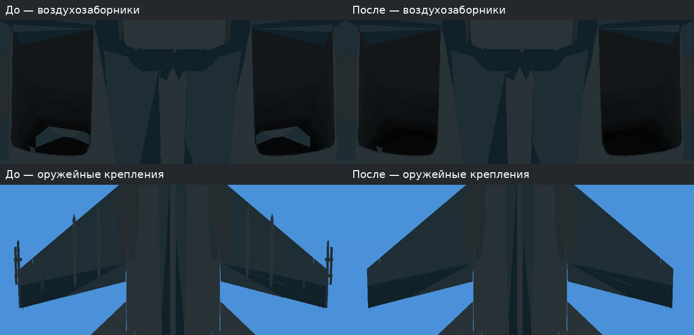

undefined
Дополнительное уточнение владельца: удалить только оружейные пилоны; кили сохранить. Проверено:10724 записи оставшихся граней SourceAirframe совпадают точно, в том числе276 граней крыла вне удаляемых креплений; элероны, рули направления и их узлы/анимации побайтно прежние. Все исходные вершины точные. Два торца закрыты только в измеренных контурах крепления направляющих, форма несущей части крыла не менялась. Данные wing-verification.json.

