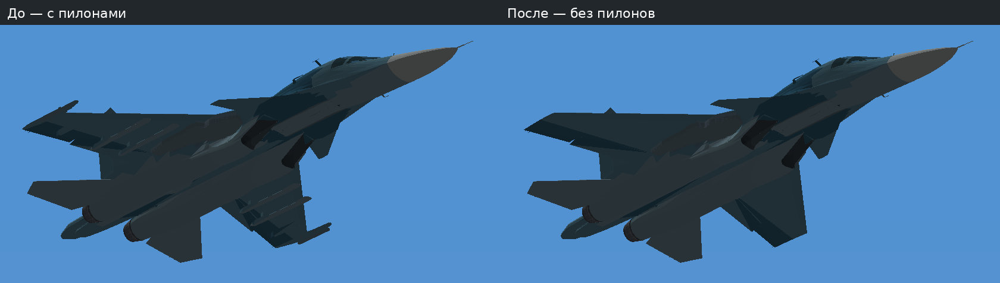
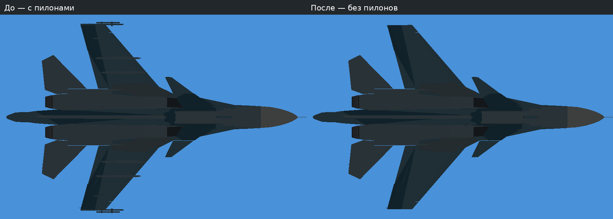

# Пилоны: сравнение всей модели

Реальные игровые кадры Windows x64 подWine, обе версии фактически открыты. До:4aaaedfe34aee1247861eec4d2547642acba1b4aa36b17ccc3d8fbef36909eb9 из сохранённого candidate.dnm.xz. После:d4dc6f68fe3761a9a5d84b8823af728dedca023e8e7c8c7ff06dde5e931a81e7 — текущая поставка. Камеры LABVIEW135/-30/115 и90/-90/130, цель(0,0,-.3), одинаковые в обеих сценах. Оружие не подвешено в обеих сценах. Шасси убраны. Только обрезка пустых полей, подписи и JPEG85; геометрия и цвета изображения не ретушировались. Снимки61.9КБ и78.0КБ. Новых правок модели, DAT или сборок нет.

